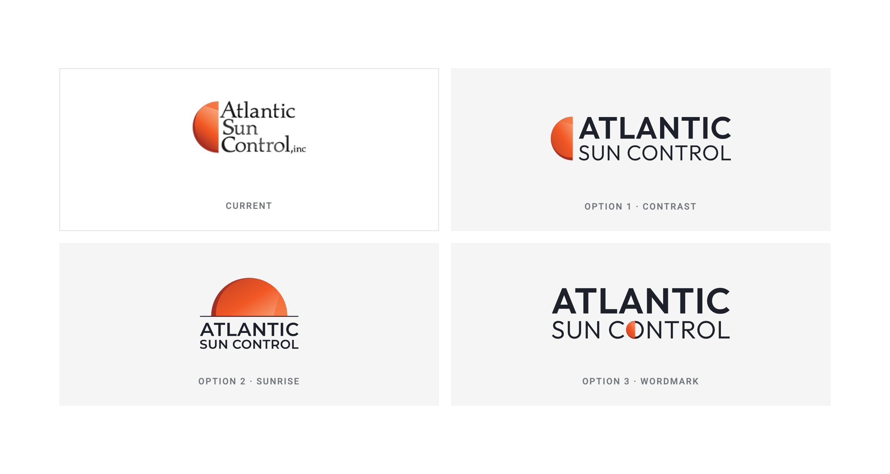

# Atlantic Sun Control: Logo Proposal

Three logo directions for Atlantic Sun Control, prepared by ImageWorks Creative.

All three keep the orange half-sun and make the same changes to the current logo:

- **Two lines instead of three.** The name now reads "ATLANTIC / SUN CONTROL" in capitals, which is simpler and easier to read.
- **No ", inc".** The name is cleaner and easier to read at small sizes.
- **New typography and layouts.** Option 1 keeps the sun beside the name, option 2 moves it above the name, and option 3 builds it into the name.
- **Vector artwork.** The half-sun has been redrawn as a vector, so it stays sharp at any size.



## Options

| | Typeface | Character |
|---|---|---|
| Option 1 · Contrast | Outfit SemiBold and Light | ATLANTIC is bold and SUN CONTROL is light, and both lines end at the same width |
| Option 2 · Sunrise | Montserrat SemiBold | Vertical and centered: the sun rises on a thin horizon line, with the name below |
| Option 3 · Wordmark | Outfit SemiBold and Light | No separate symbol: the half-sun forms the left half of the first O of CONTROL |

All the typefaces are open source (SIL Open Font License). The text in every logo file is converted to outlines, so no font needs to be installed.

## Colors

| Color | HEX | Use |
|---|---|---|
| Sun Orange | `#F15825` | Main color of the half-sun, shaded from `#F9A77F` to `#9E2D22` |
| Ink | `#1E2129` | Name on light backgrounds |
| White | `#FFFFFF` | Name on dark backgrounds |

## Files

Each option comes in a light version (for white or light backgrounds) and a dark version (for black or dark backgrounds). All files have a transparent background.

```
option-1-contrast/
  svg/   vector files (web and design use)
  pdf/   vector files (print and Adobe Illustrator)
  png/   high-resolution images
option-2-sunrise/
  svg/  pdf/  png/
option-3-wordmark/
  svg/  pdf/  png/
symbol/     the half-sun on its own
previews/   comparison image
reference/  current logo, for comparison
```

Open `index.html` in a browser to see the options in context.
